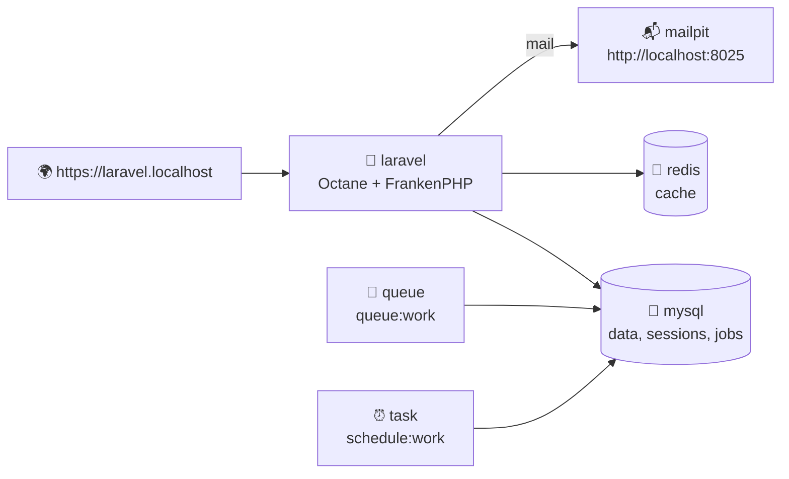

# 🔴 Laravel template

Laravel 13 website template: Octane on FrankenPHP, Vite + bun, Pest tests, queue and scheduler
containers, and the shared CI with release MR and deploys.



> [!note]
> Git hooks, commit format, releases and deploys are common to every template: see
> [base template README](https://gitlab.trust-itservices.com/websites/templates/base-template/-/blob/main/README.template.md). `README.md` is left to the website built from this template.

[[_TOC_]]

---

## 🚀 Quick start

> [!important]
> In the `websites/templates` group this is a template: create a site from it with
> [SiteKit](https://gitlab.trust-itservices.com/websites/utils/sitekit) (`sitekit new`, then choose
> `laravel`), which forks, clones and sets it up. In a website, start from the clone.

<details open>
<summary><b>First time</b></summary>

```bash
# Enable the Sail environment
source bin/activate        # bash / zsh
source bin/activate.fish   # fish
# Start the services
sail up -d
# The containers create files as root: take them back
sudo chown -R $USER:$USER .
# App key, Octane, SQLite database, migrations
sail composer run-script post-create-project-cmd
# Restart to apply the changes
sail restart
```
</details>

<details>
<summary><b>Every other time</b></summary>

```bash
source bin/activate
sail up -d
```
</details>

The site answers on `https://<SERVER_NAME>` (`SERVER_NAME` in `.env`, default `laravel.localhost`).

---

## 🔑 Environment variables

Standard Laravel configuration: `.env` locally (start from `.env.example`), on Kubernetes the
variables below. Those that matter on a deployment:

| Variable | Required | Default | Notes |
|---|---|---|---|
| `APP_KEY` | ✅ | | encryption key, unique per environment: `php artisan key:generate --show` |
| `APP_URL` | ✅ in production | `http://localhost` | base of the generated URLs |
| `DB_CONNECTION` | ✅ in production | `sqlite` | the default is a file inside the container, lost on restart: set `mysql` |
| `DB_HOST`, `DB_PORT` | | `127.0.0.1`, `3306` | |
| `DB_DATABASE`, `DB_USERNAME`, `DB_PASSWORD` | | `laravel`, `root`, empty | |
| `CACHE_STORE`, `SESSION_DRIVER`, `QUEUE_CONNECTION` | | `database` | `redis` needs the `REDIS_*` below |
| `REDIS_HOST`, `REDIS_PORT`, `REDIS_PASSWORD` | | `127.0.0.1`, `6379`, none | |
| `APP_ENV`, `APP_DEBUG` | | `production`, `false` | |
| `SERVER_NAME` | | | site address(es) of Caddy |

<details>
<summary><b>Where do they come from on Kubernetes?</b></summary>

- **Secrets** (`APP_KEY`, `DB_PASSWORD`, `REDIS_PASSWORD`, ...): AWS Secrets Manager, secret
  `external-secrets/<fullname>`, one key per variable. The chart's ExternalSecret copies it into
  the pod's Secret within an hour, or at once with
  `kubectl -n burstable annotate externalsecret <fullname> force-sync=$(date +%s) --overwrite`.
  Pods read it only at startup: `kubectl -n burstable rollout restart deployment/<fullname>`.
- **Database** (`DB_CONNECTION`, `DB_HOST`, `DB_PORT`, `DB_DATABASE`, `DB_USERNAME`, `DB_PASSWORD`):
  in the same secret, created by `helm_deploy` on the RDS instance `RDS_INSTANCE_DEV` / `_PROD` when
  the secret has no `DB_HOST`; ▶️ `db_reconfigure` gives it a new password. See
  [ci-templates](https://gitlab.trust-itservices.com/websites/utils/ci-templates#database).
- **`SERVER_NAME`**: written by `helm_deploy` (sitekit) from the CI/CD variable
  `AWS_WEB_HOST_DEV` / `AWS_WEB_HOST_PROD`.
- **`APP_ENV`**: `production`, from the image.
</details>

---

## ⛵ Sail environment

`bin/activate` creates aliases that run the tools in the containers, through
[Laravel Sail](https://laravel.com/docs/sail), so you don't type `./vendor/bin/sail` every time.

| Command | Runs |
|---|---|
| `sail` | Laravel Sail (`sail up -d`, `sail down`, `sail restart`) |
| `artisan`, `php`, `composer`, `tinker` | in the app container |
| `node`, `npm`, `bun` | in the app container |
| `mysql` | the MySQL client |
| `shell` / `root-shell` | a shell in the container (as user / as root) |
| `share`, `open` | Sail's `share` (public URL) and `open` (the site in your browser) |

---

## 🧭 Template routes

| Route | What | Docs |
|---|---|---|
| `/log-viewer` | log viewer | [opcodesio/log-viewer](https://github.com/opcodesio/log-viewer) |
| `/pulse` | Pulse dashboard | [Laravel Pulse](https://pulse.laravel.com) |
| `/telescope` | Telescope dashboard | [Laravel Telescope](https://laravel.com/docs/telescope) |

---

## ✅ Tests and code style

```bash
artisan test                  # Pest
vendor/bin/pint               # PHP code style
bunx stylelint "resources/**/*.{css,scss,vue}"
```

The CI runs the same checks on every MR and tag.

> [!tip]
> [Laravel Boost](https://laravel.com/docs/ai) is installed: `artisan boost:install` gives AI coding
> agents (Claude Code, Cursor, Copilot…) Laravel-aware tools and guidelines.

---

## 🚢 Production image

```bash
docker compose -f compose.prod.yaml up -d
```

The deploys build and run it through the shared CI: see [base template README](https://gitlab.trust-itservices.com/websites/templates/base-template/-/blob/main/README.template.md).

---

## 🆘 Troubleshooting

<details>
<summary><b>Laravel Pulse migrations not found</b></summary>

`artisan migrate` does not find them; run them explicitly (already done in production):

```bash
sail php artisan migrate --path=vendor/laravel/pulse/database/migrations/2023_06_07_000001_create_pulse_tables.php
```
</details>

<details>
<summary><b>Webserver not starting</b> (<code>could not clean default/global storage</code>)</summary>

```
WARN   unable to get instance ID; storage clean stamps will be incomplete.
ERROR  could not clean default/global storage.
ERROR  job failed.
```

Give the container user (usually `1000:1000`) access to `.config` and `.data`:

```bash
for dir in .config .data; do
    sudo chown -R <your_user>:1000 $dir && sudo chmod 0775 $dir
done
```

Fish:

```fish
for dir in .config .data
    sudo chown -R <your_user>:1000 $dir && sudo chmod 0775 $dir
end
```
</details>

---

## 🙏 Credits

- Laravel Octane Dockerfile: [exaco/laravel-octane-dockerfile](https://github.com/exaco/laravel-octane-dockerfile)
- Log viewer: [opcodesio/log-viewer](https://github.com/opcodesio/log-viewer)
- [Laravel Pulse](https://pulse.laravel.com)
- Laravel Debug Bar: [barryvdh/laravel-debugbar](https://github.com/barryvdh/laravel-debugbar)
- Framework: [Laravel](https://laravel.com/docs)
