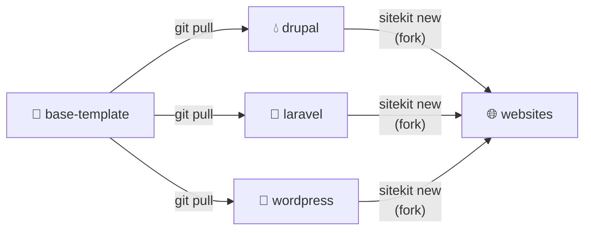

# 🧱 Base template

The common base of the **websites** templates: everything a project needs that does not depend on
its framework, i.e. CI, git hooks, release and dependency configuration.



> [!note]
> This file is `README.template.md`: each template replaces it with its own, and `README.md` is left
> to the websites built from the templates.

[[_TOC_]]

---

## 📦 What's inside

| File | What it does |
|---|---|
| `.gitlab-ci.yml` | includes the shared pipeline of [ci-templates](https://gitlab.trust-itservices.com/websites/utils/ci-templates): security checks, build, deploy, releases |
| `.pre-commit-config.yaml` | git hooks: secrets ([betterleaks](https://github.com/betterleaks/betterleaks)), branch and author ([commit-check](https://github.com/commit-check/commit-check)), commit messages |
| `commit-check.toml` | rules of the branch and author checks |
| `cliff.toml` | [git-cliff](https://git-cliff.org) config: the changelog and release notes written by the release MR |
| `renovate.json` | dependency updates by [Renovate](https://gitlab.trust-itservices.com/platform/renovate), with the shared preset |
| `.gitlab/merge_request_templates/Default.md` | description template of every MR |
| `.gitattributes`, `.gitignore`, `.dockerignore` | the shared basics |

---

## 👩‍💻 Working on a project built on it

### Git hooks

`sitekit init` installs them; by hand, with [prek](https://prek.j178.dev) (faster, same CLI) or
[pre-commit](https://pre-commit.com):

```bash
prek install    # or: pre-commit install
```

| Hook | When | Checks |
|---|---|---|
| 🔑 betterleaks | before each commit | no secrets in the staged changes |
| 🌿 check-branch | before each commit | branch name `<type>/<description>`, `type` among `feature`, `feat`, `bugfix`, `fix`, `hotfix`, `release`, `chore` |
| 👤 check-author-name / -email | before each commit | a real git identity |
| ✍️ conventional-commit | on the commit message | [Conventional Commits](https://www.conventionalcommits.org), gitmoji allowed |

### Commit messages

```text
type(scope): gitmoji subject
feat: ✨ add the newsletter block
fix(search): 🐛 escape the query
```

`type` is one of `feat`, `fix`, `docs`, `style`, `refactor`, `test`, `chore`, `ci`, `build`, `perf`,
`revert`. The CI checks every commit of a merge request the same way, and the changelog is built
from them.

> [!tip]
> A false positive of betterleaks? Append `betterleaks:allow` to that line, in a comment.

### Releases and deploys

No tags by hand: merge the release MR that the pipeline keeps up to date, then press ▶️ `promote` to
go to prod. The whole flow is in the
[ci-templates README](https://gitlab.trust-itservices.com/websites/utils/ci-templates#-releasing).

> [!note]
> This applies to the websites. The templates themselves (`websites/templates`) are not released or
> deployed: their pipeline only runs the checks. A new site starts with no version of its own: its
> first release MR proposes `0.1.0`, or the `initial_tag` set in `cliff.toml` (`[bump]`).

---

## 🆕 Creating a new template

1. Create the project, **empty** (no README), in [websites/templates](https://gitlab.trust-itservices.com/websites/templates):
   `sitekit new` lists every project of that group (except this one) as a template.
2. Pull this base into it, then add the framework, its `Dockerfile` and its CI jobs:

   ```bash
   git pull git@gitlab.trust-itservices.com:websites/templates/base-template.git main
   ```

3. Replace this `README.template.md` with the template's own docs (`README.md` is left to the
   sites), linking back here for the common parts.

## 🔄 Updating the templates

Change the shared files here, then pull them into each template, as when it was created:

```bash
git pull git@gitlab.trust-itservices.com:websites/templates/base-template.git main
```

When this `README.template.md` has changed, the pull conflicts on it: keep the template's version
(`git checkout --ours README.template.md`, then commit the merge).

> [!important]
> Sites forked from a template do not follow it: changes reach them only if pulled by hand, the same
> way. Most of the CI lives in ci-templates anyway, which Renovate keeps up to date everywhere.
